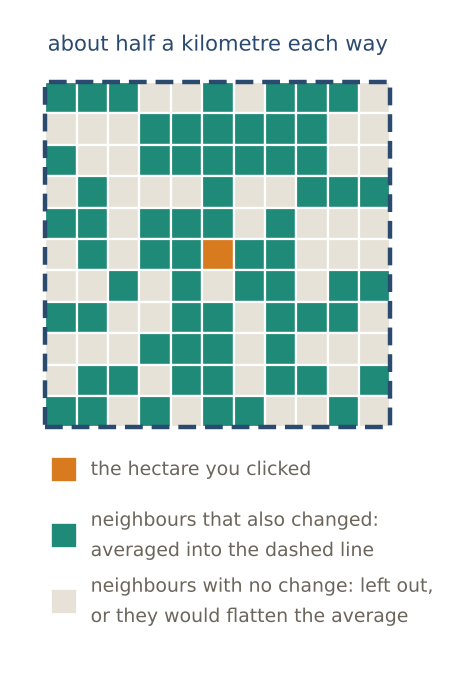

# Method

Everything below can be checked by hand from the ten numbers the page shows for any hectare. The constants live at the top of `src/common.py`.

## From the archive to ten numbers

1. **Read.** Each NISAR GCOV file is about 7 GB. The scripts open it over the network and read only the rectangle 61.9–62.6° E, 34.2–34.5° N.
2. **Average.** 10 m pixels are averaged to 50 m and then to 100 m cells, one hectare each. Averaging is always done on radar power, never on decibels. A single radar pixel is speckled; a hundred of them give a stable number.
3. **Convert.** Power becomes decibels once, at the end.
4. **Level.** On each date, the median over land outside the farmland is measured and that date's departure from the average is subtracted. Shifts of up to about 0.6 dB were found. Without this step a uniformly bright pass looks like a growing season.

## Rule 1: did anything happen?

A hectare **changed** if its strongest HV value is at least 3.0 dB above its weakest, which is a factor of 2.0.

Why doubling: on a 900-hectare block of bare ground outside the farmland, the largest swing is 1.82 dB and 0 hectares pass. The bar sits clearly above what empty ground produces.

HV is used because cross-polarized echoes respond mainly to leaves and stems. HH is shown on the page for comparison but not used to classify.

## Rule 2: when was it strongest?

- **Summer peak:** the strongest pass is 2026-08-18 or later.
- **Early peak:** the strongest pass is in June or July.

## Rule 3: did it follow its neighbours?

For each changed hectare, take the other changed hectares in the 11 × 11 block around it (about half a kilometre each way), average their curves, and compute the Pearson correlation with its own curve.

- below 0.3: **out of step**
- 0.3 to 0.7: loosely in step
- 0.7 and above: in step

Correlation compares shape only, not level.

Unchanged neighbours are left out of the average. An earlier version included them, which flattened the reference for nearly half the changed hectares and made ordinary fields look unusual. A hectare with fewer than 4 changed neighbours is reported as *too isolated to compare* and not judged.

## Places

Out-of-step hectares that touch, including diagonally, are grouped. A **place** is a group of at least 2 hectares.

## The onboard version

The replay in the page processes one pass at a time. Per hectare it keeps the lowest and highest value so far and five running sums, about 24 bytes, roughly 1 MB for the valley. It flags 182 places against 163 from full reprocessing; the two differ because the running version cannot see later passes. It runs in a browser and has not run on flight hardware.

## Why not machine learning

There are no labelled fields and no ground truth for Herat, and this is one season. A trained classifier could not be checked. Three rules that anyone can verify by hand can.
