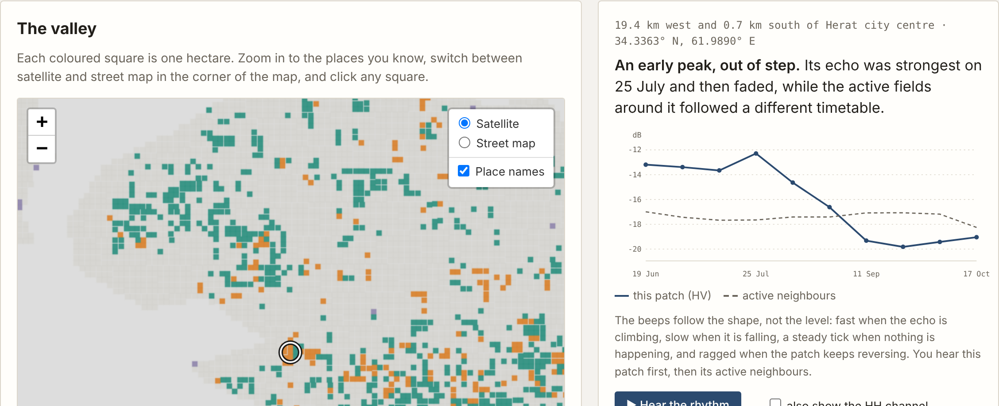
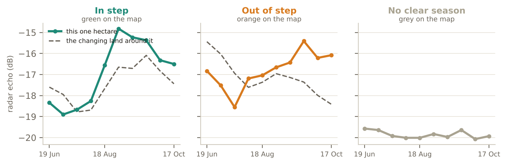

# OFFBEAT

**Which farmland around Herat, Afghanistan had a growing season this summer, and which patches did not follow the fields beside them?**

NASA Space Apps Challenge 2026 · Challenge: *Dancing with the SARs* · Seattle

**Live page:** https://masoomazahedi.github.io/offbeat/ · **Code:** https://github.com/masoomazahedi/offbeat



## The idea

Around Herat it does not rain between June and October. Farmland that still has a growing season in those months is getting water from a canal, a river or a well. Today that is learned by survey teams going household by household, which is slow and reaches a small share of the land.

NISAR's L-band radar sees through cloud and dust and returns every twelve days. Ten passes give every hectare ten measurements, and ten measurements make a shape. This project reads that shape with three simple rules and puts the answer on one map.

## What it finds

From `RESULTS.md`, written by `src/3_analyse.py`:

| | |
|---|---|
| farmland studied | 435.3 km² |
| changed strongly (echo at least doubled) | 53.7 km² |
| of that, rose to a summer peak | 32.6 km² |
| of that, peaked in June or July and faded | 21.0 km² |
| moved differently from its neighbours | 8.8 km² in 163 places |

These numbers depend on the rules. With a stricter threshold the changed area is 34.2 km²; with a looser one, 84.8 km². `RESULTS.md` has the full table. **Nothing here is validated yet**; see `LIMITS.md`.

## The three rules

1. **Did anything happen?** A hectare changed if its HV echo at least doubled (3 dB) between its weakest and strongest pass.
2. **When?** Strongest on 18 August or later is a summer peak. Strongest in June or July is an early peak.
3. **Like its neighbours?** Compare its ten values with the average of the changed hectares within about half a kilometre. Similar timing is *in step*; different timing is *out of step*.



`METHOD.md` explains each rule and why it is set where it is.

## The page

`docs/index.html` is a single static page, no server.

- A zoomable map with one coloured square per hectare, over satellite, street or terrain.
- Click a hectare for its ten measurements, a chart against its neighbours, and a verdict that keeps *measured*, *calculated* and *hypothesis* apart.
- A slider for the threshold, so the viewer can watch the headline move.
- The season played as rhythm: fast beeps while the echo climbs, slow while it falls.
- A pass-by-pass replay that keeps about 1 MB of running state and reports the flagged places in under 2 KB, as a design for onboard processing.

## Run it yourself

You need Python 3.10 or later and a free [NASA Earthdata](https://urs.earthdata.nasa.gov/) login.

```
pip install -r requirements.txt
python src/2_build_stack.py all     # reads the ten passes from NASA, about ten minutes
python src/3_analyse.py             # applies the rules, writes RESULTS.md
python src/4_build_app.py           # writes docs/data.js
```

Then open `docs/index.html`. The scripts read only the Herat window out of each 7 GB file, so nothing large is downloaded.

## Layout

```
src/          the pipeline, in the order it runs
docs/         the published page (GitHub Pages)
  index.html    structure only
  css/style.css styles
  js/core.js    data, the three rules, shared helpers
  js/map.js     the map and headline numbers
  js/detail.js  the selected-hectare panel and chart
  js/sound.js   the season as rhythm
  js/orbit.js   the pass-by-pass replay
  js/sections.js places to look first, evidence, start-up
  js/nav.js     the sidebar: phone menu and active link
  img/navimage.jpg  the sidebar image
  data.js       generated by src/4_build_app.py
aoi/          the farmland outline, derived from the radar itself
validation/   the blind check against optical imagery
METHOD.md     the rules in full
LIMITS.md     what this cannot tell you
RESULTS.md    every number, written by a script
SUBMISSION.md the text of the challenge submission
```

## Data and credits

- **NISAR L-band GCOV**, provisional Level-2 products, path 70 frame 19, from NASA's Alaska Satellite Facility. NISAR is a joint NASA and ISRO mission.
- The neighbour comparison follows the reasoning of Bazzi et al. (2019), *Remote Sensing* 11(15):1836, who separated irrigation from rainfall with Sentinel-1 in Catalonia.
- Crop calendar context from FEWS NET. Radar channel behaviour from NASA Earthdata's SAR guide.
- Basemap tiles © Esri and its data providers. Map library: Leaflet.

## Use of AI

This project was built with the assistance of Claude, an AI model made by Anthropic. Claude helped write the pipeline code, the web page and the documentation, and helped find and correct errors in the method. The author chose the problem and the place, directed the work, ran the code and is responsible for the claims. No images in this repository are AI generated; every figure is drawn from the data by the scripts.

## Licence

MIT. See `LICENSE`.
